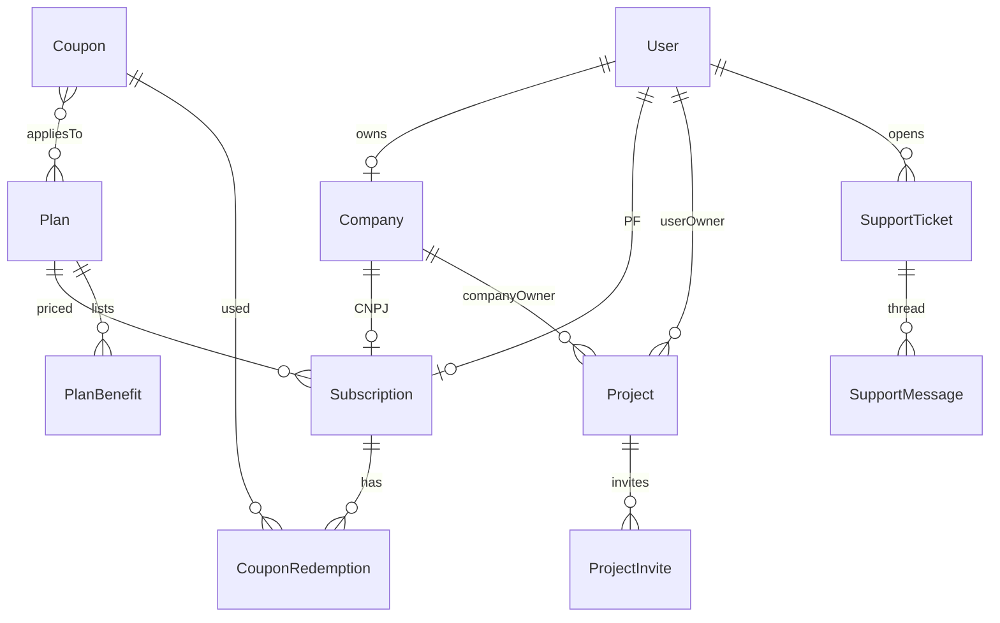

# Task Hive — Planejamento da etapa SaaS

**Data:** 25 de agosto de 2026  
**Âmbito:** backend NestJS + frontend Next.js (monorepo informal)  
**Estado de partida:** MVP de gestão de projetos/kanban/to-do/timetrack concluído; **zero** de billing, planos, convites por e-mail, landing promocional ou painel admin.

Este documento é a referência de implementação da próxima etapa. Números de quotas do plano **trial** ficam abertos de propósito (ver §5.3). Números dos planos pagos são **proposta inicial** e devem ser validados antes de ir para produção.

---

## 1. Objectivo desta etapa

Transformar o Task Hive de ferramenta interna num produto SaaS com:

1. **Landing page** comercial em `/`.
2. **Cadastro PF ou CNPJ**, com regras diferentes por tipo de conta.
3. **Sistema de empresas** (dono, projectos da empresa, convites para projectos).
4. **Planos de assinatura** com quotas e cupons de desconto.
5. **Permissionamento por plano** em toda a criação de recursos.
6. **Painel admin** (utilizadores, empresas, planos, cupons, suporte).
7. **Chat de suporte** em tempo real.
8. **Dashboard reorganizado:** tarefas avulsas à esquerda; centro só com projectos, separados entre próprios e convidados.

Fora desta etapa (explícito): gateway de pagamento, notas fiscais, Kafka, envio real de e-mail (o backend ainda não dispara mail — convites usam link copiável até a Fase 5 de e-mail existir).

---

## 2. Análise do estado actual

### 2.1 O que já existe e se reutiliza

| Área | Estado | Reuso nesta etapa |
|------|--------|-------------------|
| Auth JWT + refresh + cookies httpOnly | Pronto | Sessão admin e cliente no mesmo login |
| Roles `ADMIN_GOD`, `ADMIN_COLLABORATOR`, `CLIENT` | Pronto | Painel admin gated por role; não criar role nova |
| CRUD utilizadores (`GET /users` já é admin-only) | Pronto | Base da lista admin; falta filtros, plano, tipo de conta |
| CRUD empresas (`/companies` admin-only) | Parcial | Entidade só tem `name`; **sem dono, documento, membros** |
| Projectos com `userOwner` + `companyOwner` opcional + `participants` | Pronto | Distinguir owned vs invited; ligar `companyOwner` no cadastro CNPJ |
| Adicionar participante por `userId` (user já registado) | Pronto | Manter como fallback; convite por e-mail é novo |
| To-do 100% pessoal (`ToDo.user`) | Pronto | **Bloquear** para contas CNPJ |
| PAT (`/personal-access-tokens`) | Pronto | Enforcement de quota no `create` |
| Socket.IO (auth JWT/PAT, rooms `task:{id}`) | Só timetrack | Novo namespace `/support` no mesmo adapter |
| BFF allowlist + `proxy.ts` | Pronto | Acrescentar prefixos (`plans`, `subscriptions`, `coupons`, `invites`, `support`, `admin`) |
| Landing `/` | Placeholder “Em construção” | Substituir de raiz |
| Dashboard | Projectos e to-dos **empilhados** | Layout de duas colunas |
| Listagem de projectos | Mistura dono + participante | Separar na API e na UI |

### 2.2 Lacunas críticas (greenfield)

Não existem entidades, migrations, endpoints nem UI para:

- tipo de conta PF/CNPJ, CPF/CNPJ, dono da empresa;
- convite por e-mail/token;
- planos, quotas, cupons, assinatura;
- tickets/mensagens de suporte;
- rotas `/admin`;
- landing comercial;
- endpoint de projectos com `scope=owned|invited`.

`Company` hoje é um cadastro administrativo isolado. Qualquer `CLIENT` pode criar projecto **sem** empresa. To-do não sabe o que é empresa. PAT não tem tecto.

### 2.3 Pontos de enforcement já identificados no código

| Quota | Service actual a estender |
|-------|---------------------------|
| Projectos | `ProjectsService.create` |
| Chaves API | `PersonalAccessTokensService.create` |
| Tarefas avulsas | `ToDoService.create` |
| Convidados do projecto | `ProjectsService.addParticipant` **e** aceite de convite |
| To-do proibido a CNPJ | `ToDoService.create` + hide UI + 403 |

### 2.4 Dívida que esta etapa **não** resolve (mas convive)

- Backend Fase 2: migrar para `TypeOrmModule.forRoot()` — não bloquear o SaaS nisto.
- Cron de to-do recorrente, Kafka, e-mails transaccionais — convites e suporte funcionam in-app; e-mail fica gancho (`TODO` no serviço).
- `UserFriendship` continua opcional e fora de âmbito.
- `/settings/profile` e `/settings/api-tokens` fora do grupo `(app)` — nesta etapa, meter settings e admin no shell autenticado.

---

## 3. Decisões de produto

### 3.1 Tipos de conta (fixo no cadastro)

No `/register` o utilizador escolhe **PF** ou **CNPJ**. Não há “conta híbrida” nesta etapa. Upgrade PF → empresa fica para depois.

| | Conta PF (`INDIVIDUAL`) | Conta CNPJ (`COMPANY`) |
|--|-------------------------|------------------------|
| Identidade | `User` (pessoa) | `User` (responsável) + `Company` (dona dos projectos) |
| Documento | CPF opcional nesta etapa | CNPJ obrigatório, validado |
| Projectos | `userOwner = eu`, `companyOwner = null` | `companyOwner = empresa`, `userOwner = responsável` |
| Tarefas avulsas | Sim, com quota do plano | **Não.** UI oculta, API 403 `COMPANY_ACCOUNT_NO_TODO` |
| Convidar | Para os **seus** projectos | Para os projectos da **empresa** |
| Chaves API | Quotas do plano da pessoa | Quotas do plano da **empresa**, tokens continuam no `User` responsável |
| Assinatura | No `User` | Na `Company` (o responsável herda o plano da empresa) |

Não existe “sessão logado como empresa”. O responsável CNPJ usa a mesma sessão; o contexto vem de `accountKind` + `companyId` no payload `/auth/me`.

### 3.2 Quem é “convidado”

**Convidado** = participante de um projecto de que **não** é `userOwner`.

- Projectos próprios e projectos da empresa do responsável aparecem em **Meus projectos**.
- Projectos em que só é `participants[]` aparecem em **Projectos em que fui convidado**.
- Convidado **não** conta o projecto alheio na quota de projectos do próprio plano.
- Convidado **não** gere o projecto (`canManageProject` continua dono/admin).
- Quota de convidados é do **dono do projecto** (PF) ou da **empresa** (CNPJ), por projecto.

Convite por e-mail:

1. Se o e-mail já tem conta → ao aceitar, entra em `participants` (equivalente ao `POST .../participants` actual).
2. Se não tem conta → token de convite; no cadastro (PF ou CNPJ) o token é consumido e o user entra no projecto.

Enquanto não houver e-mail transaccional: o dono **copia o link** (`/invite/:token`). Quando o mail existir, o mesmo token é enviado.

O `POST /projects/:id/participants` com `userId` mantém-se para quem já está registado (atalho no modal actual). **Ambos** os caminhos passam pelo mesmo contador de quota.

### 3.3 Utilizador sem plano = trial

Qualquer `CLIENT` sem `Subscription` activa é tratado como **Free Trial**.

- Não inventar um terceiro estado “sem acesso”.
- Seed de um plano técnico `slug = free-trial`, `isSystem = true`, **não editável na UI de preços** (o admin pode ajustar quotas, não apagar).
- No primeiro login / após cadastro, se não houver subscription, o backend **anexa** este plano (user ou company).
- Quotas numéricas do trial: **placeholder**. Ver §5.3. O mecanismo (guard + 402/403 com código) implementa-se já; os números mudam depois sem migration de código.

Admins (`ADMIN_GOD` / `ADMIN_COLLABORATOR`) **não** consomem quotas de produto. Operam o painel e, se usarem a app como cliente, ficam isentos de tecto (ou usam o trial — decisão: **isentos**).

### 3.4 Pagamento

Cupons e planos existem como **catálogo + atribuição**. Não há Stripe/Pix nesta etapa.

Fluxos de atribuição de plano:

- Admin atribui plano a um user/empresa (com ou sem cupom).
- Futuro checkout reutiliza as mesmas tabelas (`Subscription`, `CouponRedemption`).

### 3.5 Painel admin vs app

Mesmo Next.js, grupo de rotas `(admin)` em `/admin/*`.

- Só `ADMIN_GOD` e `ADMIN_COLLABORATOR`.
- `CLIENT` a aceder `/admin` → 404 (não revelar que existe).
- Nav do admin é própria (não misturar com Painel/Projectos/To-do).
- Link “Administração” no `UserMenu` quando `isAdmin(user)`.

### 3.6 Chat de suporte

- Um **ticket** (conversa) por assunto; o cliente pode ter vários tickets.
- Mensagens persistidas; tempo real via Socket.IO.
- Cliente vê só os seus tickets; admin vê a fila global e assume o ticket.
- Sem chatbot, sem SLA automático nesta etapa.

---

## 4. Modelo de dados

### 4.1 Extensões em entidades existentes

**User**

| Campo | Tipo | Notas |
|-------|------|--------|
| `accountKind` | `INDIVIDUAL` \| `COMPANY` | Default `INDIVIDUAL` na migration (users já existentes = PF) |
| `document` | `varchar(14)` nullable | CPF só dígitos; CNPJ fica na Company |
| `ownedCompany` | `Company \| null` | 1:1 se `COMPANY` |

**Company**

| Campo | Tipo | Notas |
|-------|------|--------|
| `legalName` | varchar | Razão social (hoje só `name` — migrar `name` → `legalName` e manter `name` como nome fantasia **ou** acrescentar `tradeName` e preencher `legalName = name`) |
| `tradeName` | varchar nullable | Nome fantasia |
| `document` | `varchar(14)` unique | CNPJ só dígitos |
| `owner` | `User` | Responsável; `onDelete: RESTRICT` |
| `members` | `CompanyMember[]` | Nesta etapa: pelo menos o owner como `OWNER`. Membros extra da empresa (staff interno) **não** entram agora — convite é para **projecto**, não para a empresa. |

Decisão: **não** implementar `CompanyMember` genérico nesta etapa, para não misturar “colaborador da empresa” com “convidado do projecto”. O backend `to-do.md` Fase 5 (membros da empresa) fica **depois**. O owner é `Company.owner`.

**Project** — sem coluna nova obrigatória. Garantias:

- Conta PF: `companyOwner = null`.
- Conta CNPJ: `companyOwner` obrigatório (a empresa do responsável) no `create`.
- Listagem passa a expor `ownership: 'owned' | 'invited'` (derivado: `userOwner.id === me` → owned).

### 4.2 Entidades novas

```text
Plan
  id (uuid)
  slug (unique)            -- 'free-trial', 'starter', 'pro', 'business'
  name
  description
  accountKind              -- INDIVIDUAL | COMPANY | BOTH
  interval                 -- MONTHLY | YEARLY (catálogo; cobrança futura)
  priceCents               -- 0 no trial
  currency                 -- 'BRL'
  isActive
  isSystem                 -- true no free-trial (não apagar)
  sortOrder
  maxProjects              -- int; -1 = ilimitado
  maxApiKeys
  maxStandaloneTasks       -- ignorado / forçado 0 se accountKind=COMPANY
  maxProjectGuests         -- por projecto
  createdAt, updatedAt, deletedAt

PlanBenefit  (área de benefícios — texto comercial, além das quotas)
  id
  plan
  title                    -- ex.: "Projectos ilimitados"
  body                     -- markdown curto / texto
  icon                     -- opcional, chave fa6
  sortOrder

Coupon
  id
  code (unique, uppercase)
  type                     -- PERCENT | FIXED_CENTS
  value                    -- 10 = 10% ou 1000 = R$ 10,00
  maxRedemptions           -- null = ilimitado
  redeemedCount
  startsAt, expiresAt
  isActive
  applicablePlans[]        -- M:N; vazio = todos os planos pagos (não trial)

CouponRedemption
  id
  coupon
  subscription
  user                     -- quem aplicou (admin ou cliente futuro)
  createdAt

Subscription
  id
  status                   -- TRIAL | ACTIVE | CANCELED | EXPIRED
  plan
  user                     -- preenchido se PF
  company                  -- preenchido se CNPJ (XOR com user)
  coupon                   -- nullable
  startsAt, endsAt         -- endsAt null = sem caducidade (trial/admin)
  canceledAt
  createdAt, updatedAt

ProjectInvite
  id
  project
  email
  tokenHash
  invitedBy (User)
  status                   -- PENDING | ACCEPTED | REVOKED | EXPIRED
  expiresAt                -- default 7 dias
  acceptedBy (User) nullable
  createdAt

SupportTicket
  id
  subject
  status                   -- OPEN | PENDING_USER | PENDING_ADMIN | CLOSED
  createdBy (User)
  assignedTo (User) nullable  -- admin
  lastMessageAt
  createdAt, updatedAt

SupportMessage
  id
  ticket
  author (User)
  body (text)
  createdAt
```

Índices: `Subscription (userId)`, `(companyId)`; `ProjectInvite (tokenHash)` unique; `SupportTicket (status, lastMessageAt)`.

Regra XOR: `Subscription` tem **ou** `user` **ou** `company`, nunca ambos. Unique parcial: um subscription `TRIAL|ACTIVE` por user/company.

### 4.3 Diagrama lógico (recorte SaaS)



---

## 5. Planos e mapeamento de benefícios

Quatro eixos de quota (obrigatórios). Tudo o resto (timetrack, colunas, subtarefas) **não** tem tecto nesta etapa.

### 5.1 Recurso → regra de contagem

| Benefício | O que conta | Onde recusar | Código de erro |
|-----------|-------------|--------------|----------------|
| **Projectos** | Soft-deleted **excluídos**. PF: `userOwner = me`. CNPJ: `companyOwner = empresa`. Projectos *invited* **não** contam. | `POST /projects` | `PLAN_LIMIT_PROJECTS` |
| **Chaves API** | PAT não expirados do user autenticado. CNPJ: os tokens do responsável (não há PAT “da empresa”). | `POST /personal-access-tokens` | `PLAN_LIMIT_API_KEYS` |
| **Tarefas avulsas** | To-dos não soft-deleted do user. Contas CNPJ: recusa **antes** da quota (`COMPANY_ACCOUNT_NO_TODO`). | `POST /to-do` | `PLAN_LIMIT_TODOS` |
| **Convidados por projecto** | `participants.length` **depois** de aceitar (dono não conta). Convites `PENDING` **reservam** vaga para não estourar com dois convites em paralelo. | `POST .../participants` e `POST /invites` | `PLAN_LIMIT_GUESTS` |

Resposta HTTP sugerida: **402** (quota) ou **403** (recurso proibido ao tipo de conta), body:

```json
{
  "code": "PLAN_LIMIT_PROJECTS",
  "message": "O seu plano permite no máximo 3 projectos.",
  "limit": 3,
  "used": 3,
  "upgrade": { "slug": "pro" }
}
```

`-1` numa coluna de quota = ilimitado (não enviar `upgrade` obrigatório).

### 5.2 Catálogo proposto (planos pagos — a validar)

Valores de marketing; o admin pode alterar depois no painel. Trial não entra nesta tabela comercial.

| | Starter | Pro | Business |
|--|---------|-----|----------|
| Público | PF e CNPJ | PF e CNPJ | sobretudo CNPJ |
| Preço (proposta) | R$ 29 / mês | R$ 79 / mês | R$ 199 / mês |
| Projectos | 5 | 20 | -1 (ilimitado) |
| Chaves API | 2 | 10 | -1 |
| Tarefas avulsas (só PF) | 30 | 200 | -1 |
| Convidados / projecto | 3 | 15 | -1 |
| Benefícios texto (PlanBenefit) | Kanban, to-do, PAT | Tudo Starter + mais quotas | Tudo Pro + ilimitado + suporte prioritário (copy) |

Conta CNPJ no Starter/Pro: `maxStandaloneTasks` é **ignorado** (sempre 0 efectivo). O card de preços na landing esconde a linha “tarefas avulsas” quando o visitante filtra “Para empresas”.

### 5.3 Free Trial (a planear depois)

Implementar **já**:

- Plano sistema `free-trial`.
- Auto-subscribe no cadastro.
- Guard de quotas a ler estes quatro inteiros.

**Não implementar agora** (decisões em aberto):

- duração em dias (`endsAt`);
- o que acontece ao expirar (read-only vs bloqueio de create);
- números finais das quatro quotas;
- se o trial é só PF, só CNPJ ou ambos (default técnico: **ambos**, com `maxStandaloneTasks` só a aplicar a PF).

Placeholders no seed (só para o código não quebrar; **não publicar** na landing como oferta):

| Quota | Seed temporário |
|-------|-----------------|
| `maxProjects` | 3 |
| `maxApiKeys` | 1 |
| `maxStandaloneTasks` | 15 |
| `maxProjectGuests` | 2 |

A landing **não** mostra o trial como produto pago. CTA: “Começar grátis” → `/register`. Copy da duração/limites: “Em breve” / omitir números até o planeamento do trial.

### 5.4 Cupons

- Código único, case-insensitive.
- `PERCENT` 1–100 ou `FIXED_CENTS` (desconto no `priceCents`; não negativa o preço).
- Opcional: restringir a planos (M:N).
- Não aplicável ao `free-trial`.
- Nesta etapa o cliente **não** “compra”; o admin aplica o cupom ao atribuir um plano (grava `CouponRedemption` e o preço teórico com desconto, para o futuro checkout já ter histórico).
- Validação: activo, datas, `redeemedCount < maxRedemptions`, plano compatível.

---

## 6. Permissionamento (camadas)

Três camadas, nesta ordem, em todos os `create` relevantes:

```text
1. Auth (JWT / PAT)           — já existe
2. Role + ownership           — já existe (project-permissions.helper)
3. Tipo de conta + plano      — NOVO (PlanGuard / PlanQuotaService)
```

### 6.1 Tipo de conta

| Acção | PF | CNPJ | Convidado no projecto alheio |
|-------|----|------|------------------------------|
| Criar projecto | sim (quota) | sim, sempre com `companyOwner` da sua empresa (quota da empresa) | não (não é dono) |
| Criar to-do | sim (quota) | não | irrelevante (to-do é pessoal) |
| Criar PAT | sim (quota) | sim, quota da empresa no user responsável | sim, quota do **próprio** plano do convidado |
| Convidar para **este** projecto | se `canManageProject` e quota | idem | não |
| Ver to-do na nav / dashboard | sim | não | sim, se a conta dele for PF |

### 6.2 `GET /auth/me` (estender)

O frontend precisa disto para esconder botões **antes** do 402:

```json
{
  "id": "...",
  "name": "...",
  "email": "...",
  "role": "CLIENT",
  "accountKind": "INDIVIDUAL",
  "company": null,
  "plan": {
    "slug": "free-trial",
    "name": "Trial",
    "status": "TRIAL",
    "limits": {
      "maxProjects": 3,
      "maxApiKeys": 1,
      "maxStandaloneTasks": 15,
      "maxProjectGuests": 2
    },
    "usage": {
      "projects": 1,
      "apiKeys": 0,
      "standaloneTasks": 4,
      "projectGuests": null
    }
  }
}
```

`usage.projectGuests` só faz sentido no contexto de um projecto (`GET /projects/:id` inclui `guestUsage: { used, limit, pendingInvites }`).

Admins: `plan: null` (isentos).

### 6.3 Matriz admin

| Capacidade | ADMIN_COLLABORATOR | ADMIN_GOD |
|------------|--------------------|-----------|
| Listar/ver users e empresas | sim | sim |
| Soft-delete user/empresa | sim | sim |
| Hard-delete | não | reservado (já era a regra) |
| CRUD planos e benefícios | sim | sim |
| Apagar plano `isSystem` | não | não |
| CRUD cupons | sim | sim |
| Atribuir plano + cupom | sim | sim |
| Fila e chat de suporte | sim | sim |
| Impersonate | **não nesta etapa** | **não nesta etapa** |

---

## 7. APIs novas e alterações

Prefixo Nest na raiz; BFF: `/api/bff/<path>`. Regenerar Orval no fim de cada onda de API.

### 7.1 Cadastro e sessão

`POST /users` passa a aceitar:

```json
{
  "accountKind": "INDIVIDUAL" | "COMPANY",
  "name": "Maria Silva",
  "email": "maria@email.com",
  "password": "...",
  "confirmPassword": "...",
  "document": "00000000000",
  "company": {
    "legalName": "Acme Ltda",
    "tradeName": "Acme",
    "document": "00000000000000"
  },
  "inviteToken": "opcional"
}
```

- `COMPANY` exige `company.legalName` + CNPJ válido (dígitos verificadores).
- Transacção: User + Company + Subscription(trial) + (opcional) accept invite.
- `GET /auth/me` e payload JWT: incluir `accountKind`, `companyId?` (JWT pode ficar só `id, role`; o BFF `/me` hidrata o resto — **preferir isto** para não reemitir JWT).

### 7.2 Projectos

| Método | Path | Mudança |
|--------|------|---------|
| GET | `/projects?scope=owned\|invited\|all` | default `all` (compat); UI usa os dois scopes |
| POST | `/projects` | quota; se CNPJ força `companyOwnerId` da empresa do user; ignora id de outra empresa |
| GET | `/projects/:id` | inclui `ownership`, `guestUsage` |
| POST | `/projects/:id/invites` | `{ email }` — cria `ProjectInvite`, reserva vaga |
| GET | `/projects/:id/invites` | lista pending (gestor) |
| DELETE | `/projects/:id/invites/:id` | revoga |
| GET | `/invites/:token` | público, metadados (nome do projecto, e-mail) |
| POST | `/invites/:token/accept` | autenticado; ou cadastro com `inviteToken` |

### 7.3 Planos (público vs admin)

| Método | Path | Auth |
|--------|------|------|
| GET | `/plans` | público, só `isActive && !isSystem` (landing) |
| GET | `/plans/:slug` | público idem |
| GET | `/admin/plans` | admin, inclui trial e inactivos |
| POST/PATCH/DELETE | `/admin/plans` | admin |
| POST/PATCH/DELETE | `/admin/plans/:id/benefits` | admin |
| GET/POST/PATCH/DELETE | `/admin/coupons` | admin |
| POST | `/admin/subscriptions` | admin — `{ userId \| companyId, planId, couponCode? }` |
| GET | `/admin/subscriptions` | filtros |

### 7.4 Admin de domínio existente

| Método | Path | Notas |
|--------|------|-------|
| GET | `/admin/users` | paginação, q, accountKind, planSlug, role |
| GET | `/admin/companies` | paginação, q, document, planSlug |
| GET | `/admin/users/:id` | detalhe + usage + projectos |
| GET | `/admin/companies/:id` | detalhe + owner + projectos + plano |

Os `GET /users` e `/companies` actuais podem permanecer para não quebrar o frontend; o painel novo usa `/admin/*` com paginação de verdade (hoje `findAll` sem page).

### 7.5 Suporte

| Método | Path | Auth |
|--------|------|------|
| POST | `/support/tickets` | cliente (e admin a abrir em nome? não nesta etapa) |
| GET | `/support/tickets` | cliente: os seus; admin: todos (`?status=&q=`) |
| GET | `/support/tickets/:id` | participante (autor ou admin) |
| PATCH | `/support/tickets/:id` | status; assign só admin |
| GET | `/support/tickets/:id/messages` | |
| POST | `/support/tickets/:id/messages` | `{ body }` |

WebSocket namespace `/support`:

- handshake: mesmo JWT/cookie que o timetrack;
- `joinTicket` `{ ticketId }` se `canAccessTicket`;
- server emite `support:message` após persistir (HTTP POST **e** opcionalmente `@SubscribeMessage('support:send')` — preferir **HTTP para persistir** + emit, para o BFF/PAT também funcionarem).

### 7.6 Allowlist BFF e `proxy.ts`

Novos prefixos BFF: `plans`, `invites`, `support`, `admin`.

`proxy.ts` / matcher: `/admin`, `/support`, `/invite`, `/to-do` (já), e **esconder `/to-do` no cliente CNPJ** (página pode 404/redirect dashboard).

`TASK_HIVE_API.md`: documentar scopes de projectos, convites, códigos de quota.

---

## 8. Frontend

### 8.1 Landing (`/`)

Substituir o card “Em construção”. Secções mínimas (tema Soft Pearl, pt-BR):

1. Header: logo, âncoras (Produto, Planos), Entrar / Começar grátis.
2. Hero: proposta de valor (kanban + to-do + timetrack).
3. Produto: 3–4 blocos (projectos, tarefas avulsas PF, convites, API/PAT).
4. Planos: cards a partir de `GET /plans` (fallback copy se API down). Toggle PF / Empresa esconde a linha de to-do.
5. CTA final + footer (sem páginas legais nesta etapa, salvo links placeholder).

Visitante com sessão: CTA “Abrir painel” (já existe o padrão).

Não exigir backend de planos para publicar a landing: **v1** com copy estática igual à tabela §5.2; **v2** liga a `GET /plans` na mesma onda dos planos.

### 8.2 Cadastro

`RegisterForm`: toggle PF | CNPJ.

- PF: nome, e-mail, senha, confirmar (CPF opcional, escondido ou campo simples).
- CNPJ: nome do responsável, e-mail, senha, razão social, nome fantasia opcional, CNPJ com máscara e validação client + server.
- Query `?invite=` pré-preenche e-mail se o convite já trouxer o endereço.

### 8.3 Dashboard

Hoje: `ProjectsSection` + `ToDosSection` empilhados em `dashboard/page.tsx`; layout `(app)` centrado `max-w-6xl`.

Novo layout **só nesta página** (não sidebar global da app):

```text
+---------------------------+------------------------------------------+
| Tarefas avulsas           | Meus projectos                           |
| (coluna ~280–320px,       | [cards]                                  |
|  sticky em desktop)       |                                          |
| lista compacta + link     | Projectos em que fui convidado           |
| “Ver todas” → /to-do      | [cards]                                  |
+---------------------------+------------------------------------------+
```

- Conta CNPJ: **não** renderizar a coluna esquerda; o centro ocupa a largura. Nav “Tarefas avulsas” some no `AppHeader`.
- Mobile: to-dos **acima** (accordion) e projectos abaixo, ainda com as duas secções de projectos.
- Cards de projecto convidado: badge “Convidado”; sem botão criar nesta secção.
- `GET /projects?scope=owned` e `scope=invited` em paralelo (TanStack Query).
- Alargar o `main` do dashboard (`max-w-7xl` ou full) para caber as duas colunas; o resto das páginas pode manter `max-w-6xl`.

Página `/projects`: as mesmas duas secções (próprios / convidados). Botão “Novo projecto” só na dos próprios, desactivado com tooltip se `usage.projects >= limit`.

### 8.4 Convites na UI de projecto

Em `ProjectParticipants`, além da busca actual:

- campo e-mail “Convidar”;
- lista de convites pending + revogar;
- indicador `3 / 15 convidados` (usage + pending).

Página pública `/invite/[token]`: nome do projecto; se sem sessão → login/cadastro com `next=/invite/token`; se sessão → botão Aceitar.

### 8.5 Quotas na UI (cliente)

- Botões Criar projecto / Criar to-do / Gerar token / Convidar: disabled + mensagem “Limite do plano” + link “Ver planos” (página `/settings/plan` simples: plano actual, usage, tabela de upgrade **informativa** — sem checkout).
- Página PAT já existente: mostrar `x / max` chaves.

### 8.6 App de suporte (cliente)

Rota `/support` no grupo `(app)`:

- lista de tickets + “Nova conversa”;
- thread com polling curto **e** Socket.IO (`/support`);
- item de nav ou entrada no `UserMenu`.

### 8.7 Painel admin (`/admin`)

Layout próprio (`src/app/(admin)/layout.tsx`): nav lateral admin (desktop) + header.

| Rota | Conteúdo |
|------|----------|
| `/admin` | Resumo: nº users, empresas, tickets abertos (contagens simples) |
| `/admin/users` | Tabela paginada, busca, filtros, detalhe drawer/página |
| `/admin/companies` | Idem |
| `/admin/plans` | Lista + editor de quotas e **área de benefícios** (CRUD `PlanBenefit`) |
| `/admin/coupons` | CRUD cupons, redemptions |
| `/admin/support` | Fila de tickets + chat (mesmo componente de thread que o cliente) |

Guard: se `role` não for admin → `notFound()`. Estender `requireSessionUser` ou helper `requireAdmin()`.

Mover `/settings/api-tokens` para o shell autenticado na mesma onda de layout, se tocar no header.

### 8.8 Ficheiros frontend principais a criar/alterar

| Acção | Path |
|-------|------|
| Alterar | `src/app/page.tsx` (landing) |
| Alterar | `src/components/auth/register-form.tsx` |
| Alterar | `src/app/(app)/dashboard/page.tsx` + `projects-section.tsx` + `todos-section.tsx` |
| Alterar | `src/components/layout/app-header.tsx`, `user-menu.tsx` |
| Alterar | `src/lib/projects-api.ts`, `session.ts`, `bff-allowlist.ts`, `proxy.ts` |
| Alterar | `src/components/projects/project-participants.tsx`, `projects-view.tsx` |
| Criar | `src/app/(app)/support/**`, `src/app/invite/[token]/page.tsx` |
| Criar | `src/app/(admin)/**`, `src/components/admin/**` |
| Criar | `src/components/landing/**` |
| Criar | `src/lib/plan-quota.ts` (helpers UI) |
| Testes | `tests/unit/...` espelhando; E2E smoke cadastro PF/CNPJ, quota, admin 404 para client |

---

## 9. Chat de suporte — detalhe técnico

- Persistência obrigatória (`SupportMessage`). O WS só notifica.
- Room `ticket:{id}` no namespace `/support` (não misturar com rooms `task:` do default namespace).
- CORS/credentials iguais ao timetrack; `PUBLIC_WS_URL` já cobre o Nginx `/socket.io/`.
- Métricas Prometheus: reutilizar padrão do gateway de timetrack (`connections`, eventos).
- Rate limit no `POST` de mensagens (ex.: 30/min por user).
- Sem upload de ficheiros nesta etapa.
- Fechar ticket: admin ou autor; reabrir: autor se `CLOSED`.

---

## 10. Ondas de implementação

Ordem pensada para cada onda ser **mergível** e demonstrável. Backend e frontend da mesma onda no mesmo ciclo. Estimativas em “tamanho relativo” (S/M/L), não em dias.

### Onda 0 — Fundação de dados — **M**

- Enums `AccountKind`, entidades Plan / PlanBenefit / Coupon / Subscription.
- Migration + seed: `free-trial` + três planos pagos com quotas da tabela §5.2 + benefícios texto.
- `PlanQuotaService` com `assertCan(user, resource)` e contagens.
- Estender `User.accountKind`; `Company.owner`, `document`, `legalName`/`tradeName`.
- Users existentes: `INDIVIDUAL` + auto trial (script de backfill).
- Testes unitários do validador de CNPJ e das contagens.

**Critério de pronto:** seed corre; nenhum endpoint de produto ainda recusa quota (serviço existe, ainda não está ligado) **ou** ligar já nos quatro `create` com o trial — preferir **ligar já** para não lançar UI sem tecto.

### Onda 1 — PF/CNPJ + bloqueio to-do — **M**

- `POST /users` discriminado; transacção User+Company+Subscription.
- JWT/`/me` com `accountKind` e `company` + `plan.usage`.
- `ProjectsService.create` força empresa no CNPJ; quota de projectos.
- `ToDoService.create` 403 para CNPJ; quota para PF.
- PAT: quota.
- Frontend: toggle no registo; nav/dashboard/to-do escondidos para CNPJ; proxy redirect `/to-do` → `/dashboard`.
- Testes E2E: cadastro CNPJ não cria to-do; PF cria até ao limite.

### Onda 2 — Convites e projectos separados — **M**

- Entidade `ProjectInvite`; endpoints §7.2; reserva de vaga.
- `GET /projects?scope=`.
- UI: duas secções no dashboard e em `/projects`; badge Convidado.
- Modal de participantes: convite por e-mail + lista pending.
- `/invite/[token]` público.
- Quota `PLAN_LIMIT_GUESTS` nos dois caminhos (userId e e-mail).

### Onda 3 — Dashboard layout + landing v1 — **S/M**

- Layout duas colunas no dashboard (§8.3). Testes RTL das secções (já estavam pendentes no `FrontEnd/to-do.md`).
- Landing estática (copy §5.2 + hero). Ainda pode não bater na API de planos.

Pode avançar **em paralelo** com a Onda 1 no frontend da landing.

### Onda 4 — Planos, benefícios, cupons, admin de catálogo — **L**

- CRUD admin planos/benefícios/cupons/subscriptions.
- `GET /plans` público.
- Landing v2 liga aos planos.
- `/settings/plan` (usage + tabela informativa).
- UI de limites nos botões de criar (402 tratado em `api-error.ts`).
- Admin UI: `/admin/plans`, `/admin/coupons`.

### Onda 5 — Painel admin users/empresas — **M**

- `GET /admin/users`, `/admin/companies` paginados.
- Tabelas + detalhe + atribuir plano.
- Reusar listagens que o backend já tem só como fallback; o painel novo não deve `GET /users` sem paginação em produção.

### Onda 6 — Suporte — **L**

- Módulo Nest + gateway namespace `/support`.
- UI cliente `/support` + admin `/admin/support`.
- Testes E2E: cliente abre ticket; admin responde; evento WS (espelhar o padrão do timetrack gateway).

### Onda 7 — Fecho — **S**

- Allowlist, `TASK_HIVE_API.md`, OpenAPI + `npm run api:generate`.
- Ligar este ficheiro a partir dos `to-do.md` (backend Fase 5 empresa + frontend Fase 6).
- README raiz: entrada “Etapa SaaS”.
- Revisar security: IDOR em convites, tickets, admin; CNPJ único; não vazar existência de `/admin` a CLIENT.

```text
Onda 0 → 1 → 2 → 4 → 5 → 6 → 7
              ↘ 3 (landing + dashboard) pode paralelo após 1
```

A Onda 3 (layout dashboard) **depende** da Onda 2 para as duas listas de projectos; o CSS da coluna de to-dos pode começar no fim da Onda 1.

---

## 11. Módulos NestJS novos (proposta)

| Módulo | Responsabilidade |
|--------|------------------|
| `PlansModule` | Catálogo, benefícios, quotas (serviço partilhado) |
| `SubscriptionsModule` | Estado da assinatura, atribuição admin, auto-trial |
| `CouponsModule` | Validação e redemption |
| `InvitesModule` | Tokens de convite a projecto |
| `SupportModule` | Tickets, mensagens, gateway |
| `AdminModule` | Controllers agregados `/admin/*` (ou controllers `admin-*.controller.ts` nos módulos de domínio) |

Preferir **controllers admin dentro do módulo de domínio** (`UsersAdminController`) para não criar um God-module, com prefixo `admin` e `@Roles`.

`PlanQuotaService` vive em `PlansModule` e é importado por Projects, ToDo, Auth/PAT, Invites.

---

## 12. Testes mínimos por onda

| Onda | Backend | Frontend |
|------|---------|----------|
| 0 | Unit quotas; migration seed | — |
| 1 | E2E register PF/CNPJ; 403 to-do CNPJ; 402 no 4.º projecto trial | RTL register toggle; nav sem to-do |
| 2 | E2E invite accept; 402 guests; scope owned/invited | RTL duas secções; smoke convite |
| 3 | — | RTL dashboard colunas; smoke landing pública |
| 4 | E2E CRUD plan/coupon; cupom inválido | Admin plans (se role); landing cards |
| 5 | E2E admin list paginada; CLIENT 403 | CLIENT `/admin` 404 |
| 6 | E2E ticket + WS message | Smoke thread |

Manter o padrão actual: Vitest em `FrontEnd/tests/`, Jest e2e em `backend/test/`.

---

## 13. Fora de âmbito (backlog imediato a seguir)

- Checkout, gateway, NF-e, gestão de falha de pagamento.
- Números e duração finais do **trial**.
- Colaboradores da empresa (`CompanyMember`) — distinto de convidado de projecto.
- Conversão PF → CNPJ e multi-empresa por user.
- Impersonate admin.
- E-mail transaccional / Kafka (ganchos só).
- Upload no suporte; Canned responses.
- Drag-and-drop kanban, toasts globais, perfil (`FrontEnd/to-do.md` Fase 6 perfil) — perfil pode entrar se o admin de users precisar editar nome/e-mail; senão fica no backlog de settings.
- Amizades (`UserFriendship`).

---

## 14. Riscos e cuidados

| Risco | Mitigação |
|-------|-----------|
| Quota furada por corrida (dois POST simultâneos) | Transacção + `SELECT ... FOR UPDATE` na subscription ou count na mesma TX |
| Convites pending a inflar convidados | Pending conta para o tecto; expirar via query no accept (cron depois) |
| Users antigos sem `accountKind` | Backfill `INDIVIDUAL` + trial na migration |
| Empresa actual sem `owner` | Migration: empresas órfãs ficam só visíveis ao admin até se atribuir owner; `create` de projecto CNPJ recusa empresa sem owner |
| JWT desactualizado após mudar plano | Quotas lidas **sempre** da BD no request, não do JWT |
| CNPJ duplicado | Unique no `company.document` |
| PAT de convidado vs plano da empresa | Documentado: PAT é sempre do user autenticado |
| `.git/config` a 0 bytes no Cursor | Não mexer em git config; commits só se pedidos |
| BFF 403 em paths novos | Onda 7 no fim de **cada** onda que exponha path novo (não deixar para o fim real) — na prática: actualizar allowlist **na mesma PR** da API |

---

## 15. Critérios de aceite da etapa (definição de pronto)

- [ ] Cadastro PF e CNPJ; CNPJ não vê nem cria tarefas avulsas.
- [ ] Projectos próprios e convidados separados no dashboard e em `/projects`.
- [ ] Dashboard: to-dos à esquerda (PF); centro só projectos.
- [ ] Convite por e-mail com link; quota de convidados por projecto respeitada.
- [ ] Quotas de projectos, PAT, to-dos e convidados aplicadas; trial automático sem plano pago.
- [ ] Admin gere users, empresas, planos (quotas + benefícios texto), cupons e atribui planos.
- [ ] Landing comercial em `/` com CTA para registo/login.
- [ ] Cliente e admin trocam mensagens de suporte persistidas, com actualização em tempo real.
- [ ] OpenAPI, BFF allowlist, `TASK_HIVE_API.md` e testes das ondas 1–6 no mínimo no caminho feliz + um caso de quota.

---

## 16. Referências no repositório

| Recurso | Path |
|---------|------|
| Este plano | `PLANEJAMENTO-ETAPA-SAAS.md` |
| Roadmap backend (empresa ainda “futuro”) | `backend/to-do.md` Fase 5 |
| Roadmap frontend (empresas/admin Fase 6) | `FrontEnd/to-do.md` |
| Análise antiga do backend (desactualizada em timetrack/participantes) | `backend/ANALISE-PROJETO.md` |
| Integração BFF/PAT | `TASK_HIVE_API.md` |
| Convenções UI | `FrontEnd/.cursor/rules/task-hive-conventions.mdc` |
| Permissões de projecto actuais | `backend/src/projects/project-permissions.helper.ts` |
| Dashboard actual | `FrontEnd/src/app/(app)/dashboard/page.tsx` |
| Landing actual | `FrontEnd/src/app/page.tsx` |

Quando esta etapa arrancar, actualizar os checkboxes dos `to-do.md` com apontador para as ondas deste ficheiro, em vez de duplicar o texto.
